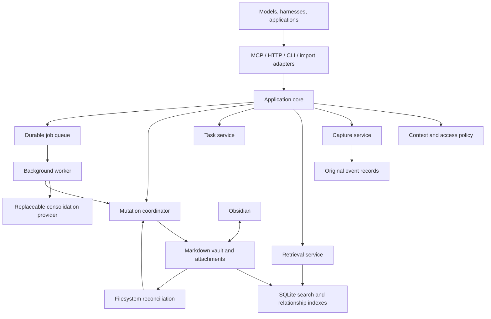
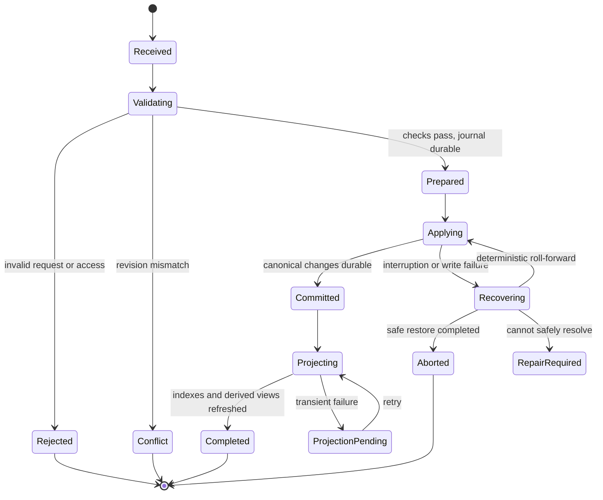

# Portable AI Memory System — Design Reference

Version: 0.3  
Date: 2026-11-24  
Status: Architecture baseline with v1 implementation status and dynamic area contract  
Implementation status: v1 core, schemas, dynamic areas, revision history, cascading deletion, background worker, PDF/text extraction, and MCP/HTTP adapters implemented (see [Section 20: Implementation status matrix](#20-implementation-status-matrix))

For host deployment conventions and client access patterns, see [Section 19: Host deployment conventions](#19-host-deployment-conventions).

## 1. Purpose and document status

Build a user-owned memory system that different AI models, providers, harnesses, and applications can use. Changing the model or harness should not require migrating the underlying memory.

This document consolidates the design discussion. The architecture and requirements reflect the choices made in that discussion. The detailed record templates, operation contracts, and mutation states below are proposed specifications for implementation and review; they have not yet been tested.

Two implementation refinements are proposed here to remove ambiguity:

1. Store each task as a separate authoritative record. Area-level `TASKS.md` files become generated task dashboards, rather than a second source of task truth.
2. Define all-or-recover semantics for multi-file mutations. Filesystem writes are not a cross-file ACID transaction; the service uses a durable journal, consistent service reads, and crash recovery.

## 2. Requirements and boundaries

### Confirmed requirements

- One central memory shared across replaceable models and harnesses.
- Windows and Linux clients on a dual-boot primary machine.
- A separate low-power Linux host runs the service and storage (designed to run comfortably on modest hardware, e.g., dual-core CPU and ~8 GB RAM).
- Host stays powered on during work for the initial version.
- Same-network access initially; remote networking is deferred.
- Separate work, internships/corporate activity, personal life, personal projects, skills, and open-source contributions.
- An explicitly shared pool and an owner overview combining work and personal context.
- Short-term detailed capture plus long-term facts, decisions, state, lessons, and summaries.
- Automatic updates to both memory layers, with provenance and uncertainty handling.
- Obsidian-readable Markdown, internal links, and original PDF storage.
- Task records and a daily actionable view.
- A discoverable introduction for newly connected agents and consistent operating rules.
- Gemini API is the provisional consolidation backend; the backend must remain replaceable.

### Boundaries

- Shared information does not guarantee identical behaviour across models.
- Full capture means everything accessible through the selected integration. Coverage must be disclosed per session.
- MCP is an access protocol, not a universal conversation interception mechanism.
- This borrows a short-term/long-term memory concept; it does not require an LSTM neural network.
- Raw retention is configurable. Moving sessions out of routine retrieval does not imply deletion.
- No local LLM, vector database, distributed service architecture, or remote access is required for v1.

## 3. System architecture



Use one service process with modular components and one bounded background worker initially. Proposed implementation language: Python. MCP and HTTP call the same application functions. A CLI can use HTTP; import adapters submit the same event contract.

### Component ownership

| Component | Responsibilities |
| --- | --- |
| Context manager | Open/refresh application contexts, select project, produce bootstrap packet |
| Access policy | Resolve credentials and scopes; authorize every operation and returned reference |
| Capture service | Validate, deduplicate, and persist original events |
| Retrieval service | Scoped search, page reads, relationship traversal, context assembly |
| Task service | Validate task creation and transitions; build daily views |
| Mutation coordinator | Serialize writes, check revisions, journal changes, recover interruptions |
| Background worker | Consolidate event chunks, extract documents, refresh derived views |
| Provider adapter | Convert bounded inputs into structured proposals; report usage and failures |
| Filesystem reconciler | Detect manual edits, distinguish service writes, handle conflicts and renames |

## 4. Directory layout and bootstrap files

```text
memory-home/
  vault/                          # Open in Obsidian
    START-HERE.md
    PROFILE.md
    SUMMARY.md
    TODAY.md
    System/
      Rules/
        READ.md
        CREATE.md
        UPDATE.md
        DELETE.md
        MEMORY.md
        TASKS.md
      Templates/
        Project.md
        Memory.md
        Session.md
        Task.md
        Document.md
    Shared/
      INDEX.md
      Preferences.md
      Knowledge/
    Work/
      INDEX.md
      TASKS.md
      Tasks/
      Internships/
      Corporate/
      Projects/
      Sessions/
      Memories/
      Documents/
    Personal/
      INDEX.md
      TASKS.md
      Tasks/
      Life/
      Skills/
      Projects/
      Open-source/
      Sessions/
      Memories/
      Documents/
  records/                        # Authoritative original capture
  config/                         # Deployment and access policy; no committed secrets
  schemas/                        # Machine-readable record/operation validation
  journal/                        # In-flight mutation recovery data
  runtime/                        # SQLite, extraction cache, temporary files
```

Projects can acquire their own `Tasks/`, `Sessions/`, `Memories/`, and `Documents/` folders. Do not create fictional employers, projects, or profile information to populate the structure.

| File | Meaning | Ownership |
| --- | --- | --- |
| `START-HERE.md` | System purpose, entry flow, navigation, operation rules | Controlled, versioned policy |
| `PROFILE.md` | Stable introduction with supported background, interests, and broad goals | Maintained record with preserved manual corrections |
| `SUMMARY.md` | Combined current overview for the owner | Derived from accessible underlying records |
| `TODAY.md` | Scheduled, overdue, active, blocked, and suggested-next tasks | Derived from task records |
| Area `INDEX.md` | Description and navigation | Maintained overview |
| Area `TASKS.md` | Task dashboard | Derived from individual task records |
| Rules/templates | Behaviour and formatting contract | Controlled, versioned policy |

The full owner profile/summary/daily files are not automatically shared with every client. Restricted clients receive scope-filtered views assembled from permitted source records. Do not read a mixed summary first and attempt to redact it afterward.

## 5. Storage and authority

| Data | Authoritative location | Rebuildable? |
| --- | --- | --- |
| Original events | Immutable event files under `records/` | No |
| Current memory/task/project content | Markdown plus structured frontmatter | No |
| Original attachments | Scoped document storage | No |
| Search and relationship indexes | SQLite | Yes |
| Generated dashboards/summaries | Markdown projections with source revisions | Yes |
| Extraction/OCR text | Derived cache | Yes, given originals and tooling |
| Jobs/checkpoints/contexts | SQLite operational tables | Recoverable only with explicit replay rules |
| In-flight writes | Durable mutation journal | Required until completed or safely aborted |

The service is the write gateway for automated clients. Obsidian remains a supported manual editor, with edits reconciled before automated replacement. Keep credentials outside the vault and exclude them from exports, logs, and ordinary backups.

## 6. Common record model

### Common fields

| Field | Contract |
| --- | --- |
| `schema_version` | Versioned record schema |
| `id` | Permanent opaque identifier, independent of path and title |
| `type` | Record kind |
| `scope_id` | Exactly one owning scope |
| `project_id` | Optional stable project reference |
| `title` | Human-readable label |
| `revision` | Monotonically increasing integer for mutable records |
| `recorded_at` | Capture time; UTC timestamp |
| `updated_at` | Last accepted revision time; UTC timestamp |
| `occurred_at` | Optional underlying event time; may be unknown |
| `valid_from`, `valid_until` | Optional applicability interval |
| `origin` | Explicit user statement, observation, inference, or import |
| `status` | Type-specific state |
| `sources` | Stable evidence references with passages/page numbers where available |
| `relations` | Typed links using stable IDs |
| `processing` | Extractor/model/schema versions and extraction time, when applicable |

Store timestamps in UTC and render dates with the configured user timezone. Preserve date-only values as dates rather than inventing times. Never substitute the capture date for an unknown occurrence date.

### Relationship types

`supports`, `contradicts`, `supersedes`, `summarizes`, `part_of`, `related_to`.

Render readable Obsidian links, but resolve identities through IDs. A filename rename must not create a new entity. Unresolved or inaccessible links must not leak private titles or paths through API responses.

## 7. Proposed record templates

Examples below use illustrative IDs and content. Production IDs should be generated by the service. Field values are data, not instructions.

### 7.1 Original event — JSON

```json
{
  "schema_version": "1.0",
  "id": "evt_example",
  "session_id": "ses_example",
  "scope_id": "personal/project-example",
  "source_application": "generic-adapter",
  "source_event_id": "upstream-message-42",
  "sequence": 12,
  "speaker": "user",
  "event_type": "message",
  "recorded_at": "2026-11-24T10:00:00Z",
  "occurred_at": null,
  "content": "I am trying Rust this week.",
  "attachment_ids": [],
  "source_reference": null
}
```

Events are immutable. Corrections refer to earlier events. Capture speaker roles faithfully; assistant text must not become a user assertion. Deduplication uses authenticated client identity plus stable upstream event identity where available. Reusing the same identity with different content is a conflict. A content hash alone must not discard legitimately repeated messages.

### 7.2 Maintained memory — Markdown

```markdown
---
schema_version: "1.0"
id: mem_example
type: state
scope_id: personal/project-example
project_id: prj_example
title: Temporary Rust evaluation
revision: 1
status: current
origin: explicit_user_statement
recorded_at: "2026-11-24T10:00:00Z"
updated_at: "2026-11-24T10:00:00Z"
valid_from: null
valid_until: null
sources:
  - record_id: evt_example
    quote: "I am trying Rust this week."
relations:
  - type: part_of
    target_id: prj_example
---
# Temporary Rust evaluation

The user is evaluating Rust temporarily. This does not establish a lasting
language preference. Resolve the phrase “this week” using the source context
before assigning an exact validity interval.
```

Memory types: `fact`, `preference`, `decision`, `state`, `lesson`, `summary`. Statuses: `current`, `uncertain`, `disputed`, `superseded`, `retracted`. These describe a claim's standing; archive/deletion lifecycle is separate.

Decisions additionally capture rationale, alternatives when known, and evidence of acceptance. Summaries list covered source IDs/revisions and their coverage interval. Repetition through summaries does not count as independent evidence.

### 7.3 Task — Markdown

```markdown
---
schema_version: "1.0"
id: task_example
type: task
scope_id: personal/project-example
project_id: prj_example
title: Review the memory record schema
revision: 1
status: next
priority: normal
scheduled_date: null
due_date: null
blocked_reason: null
depends_on: []
completed_at: null
sources:
  - record_id: evt_task_request
---
# Review the memory record schema

## Acceptance criteria
- Identify required fields and unresolved design questions.

## Notes
No deadline has been stated.
```

Task statuses: `inbox`, `next`, `in_progress`, `blocked`, `done`, `cancelled`. Priority: `low`, `normal`, `high`, `urgent`; default `normal`, never inferred urgency without evidence. Assistant suggestions enter `inbox` and are labelled proposals. A scheduled date is not a due date. Dependencies use task IDs.

### 7.4 Project — required sections

Frontmatter: common identity/revision fields, project status, optional parent scope, source references. Body: purpose, current outcome, current state, blockers, next steps, decisions, tasks, documents, and session links. Unknown sections remain empty or explicitly unknown.

### 7.5 Session — required fields

ID, context ID, source application, scope/project, start/end timestamps, capture coverage (`full_accessible_transcript`, `partial_events`, `summary_only`), known gaps, processing checkpoint, handoff-summary reference. Coverage must not imply access to hidden reasoning or unavailable application history.

### 7.6 Document companion — required fields

Document ID, scope/project, original attachment reference, original filename, media type, checksum, acquisition source/date, extraction status, page count when known, and links to derived notes. Text excerpts retain PDF page references. Original binaries are not overwritten by extraction.

## 8. Access and bootstrap contract

Scopes include `shared`, work general/project scopes, and personal general/project scopes. Sharing is explicit; linking does not grant access. A session's scope is derived from authenticated policy, not trusted merely because a model supplied it.

```text
effective access = credential permissions intersect selected context permissions
```

`open_context` returns a context ID, allowed scopes, policy version, compact introduction, permitted profile/overview, relevant daily tasks, and navigable references. Normal memory operations require a valid application context. This is an application-level concept, independent of MCP transport sessions.

A service cannot universally force a harness to consume a pushed file. Advertise the entry flow through available tool descriptions and supported server metadata/instructions. Enforce the context requirement server-side. Receiving the rules does not prove that a model understood them.

Profile facts, summaries, document excerpts, and linked-page metadata all require scope checks. Apply restrictions before retrieval and before constructing external-provider requests. Derived records inherit source restrictions unless explicitly released under a sharing policy.

## 9. Proposed operation schemas

### 9.1 Common request and response shapes

HTTP routing and MCP mapping are adapters around this logical contract. The envelope need not duplicate a transport's native fields.

```json
{
  "api_version": "1",
  "operation": "update_memory",
  "context_id": "ctx_example",
  "idempotency_key": "req_example",
  "input": {
    "record_id": "mem_example",
    "expected_revision": 1,
    "changes": {
      "status": "superseded"
    },
    "reason": "Replaced by a sourced current record",
    "source_ids": ["evt_correction"]
  }
}
```

```json
{
  "request_id": "srv_request_example",
  "ok": true,
  "data": {
    "record_id": "mem_example",
    "revision": 2,
    "mutation_id": "mut_example"
  },
  "policy_version": "1",
  "warnings": []
}
```

Errors use `ok: false` with `error.code`, safe `error.message`, `retryable`, and optional structured conflict details available only to authorized callers. Idempotency keys are mandatory for mutations and capture batches. Scope them by authenticated client; bind each key to a canonical request hash. Same key/different payload is an error. Document retention of completed idempotency receipts before implementation.

### 9.2 Operation contracts

| Operation | Required input | Output / validation |
| --- | --- | --- |
| `open_context` | Requested purpose and optional project/scope selection | Context, permitted bootstrap packet, policy version, expiry; no context required beforehand |
| `start_session` | Context, application label, capture coverage | Session ID; coverage and scope validated |
| `append_events` | Session ID, batch ID, event array | Durable accepted/duplicate IDs; reject conflicting event identities |
| `search_memory` | Query, optional permitted filters, bounded limit | Excerpts, IDs, revisions, source references; no inaccessible metadata |
| `read_page` | Record ID, optional section/size limit | Authorized content, revision, permitted related references |
| `create_memory` | Type, owning scope, title/body, origin, sources | ID/revision; validate sources, scope, template, duplicate candidates |
| `update_memory` | ID, expected revision, allowlisted changes, reason, sources | New revision; cannot mutate identity, grant access, or overwrite original events |
| `create_task` | Scope, title, origin, sources; optional scheduling fields | Task ID/revision; suggested tasks default to inbox |
| `update_task` | ID, expected revision, allowlisted changes, evidence | New revision; validate transition and dependency references |
| `ingest_document` | Authorized scope, original bytes/upload reference, media metadata | Document ID and queued extraction status; enforce size/type limits |
| `end_session` | Session ID, optional accessible final events | Capture acknowledgement and queued consolidation job IDs |
| `archive_record` | ID, expected revision, reason | Hidden from routine active views; recoverable |
| `forget_record` | ID, expected revision, explicit deletion intent and target policy | Deletion job/receipt; separately report derived cleanup and backup limitations |

All array sizes, body sizes, attachment sizes, and result lengths need configured bounds. Reject unknown mutation fields and unsupported enum values. Separate allowlists by record type. Date fields must have defined formats. No operation accepts an arbitrary filesystem path to read or write outside controlled storage.

### 9.3 Error codes

`authentication_required`, `context_required`, `context_expired`, `policy_refresh_required`, `not_found_or_unavailable`, `validation_failed`, `revision_conflict`, `idempotency_conflict`, `source_conflict`, `temporarily_unavailable`, `processing_failed`.

Use indistinguishable missing/inaccessible lookup errors where needed to prevent existence leaks. A returned record conflict must not disclose a record the caller cannot read.

## 10. Mutation state machine



### State meanings and guarantees

- **Received:** request identity registered. A retry can find the same operation.
- **Validating:** authenticate, authorize, check schema, evidence, current hashes/revisions, and policy.
- **Prepared:** durable journal contains before/after references, target revisions, and recovery instructions. No unrecorded write is permitted.
- **Applying:** serialized coordinator writes staged content and replaces destination files. No competing service mutation may modify these targets.
- **Committed:** canonical changes and commit marker are durable. Report committed revision even if projections lag.
- **Projecting:** refresh search, relationship indexes, summaries, and task views. Each projection records its source revision/checkpoint.
- **Completed:** required projections are current and idempotency receipt is stored.
- **Recovering:** replay the journal before exposing affected records as current. Never guess based only on filenames.
- **RepairRequired:** quarantine affected mutations from automated writes, preserve evidence, surface a health failure. Do not silently discard user edits.

Readers must not observe a partially applied logical change through the service. Implement a read/write boundary or equivalent consistent snapshot. External editors can still observe intermediate files; this limitation must be documented. After a crash, recover incomplete mutations before serving affected content. Strict crash durability requires testing actual filesystem flush and replacement behaviour on the deployment host.

Manual edits can occur outside service locks. Compare the expected revision and file content hash before replacement. If files change during preparation/application, preserve conflicting versions and reconcile instead of overwriting them. A single atomic rename alone does not solve external-editor races.

## 11. Update and consolidation rules

1. Persist original input before acknowledging capture.
2. Segment events into bounded chunks; retain continuity references across chunks.
3. Send only policy-permitted data to the configured backend.
4. Ask for structured proposals, never unrestricted file edits.
5. Validate source existence, exact passages/page references, scope, origin, and type-specific constraints.
6. Recheck revisions before committing; model output may already be stale.
7. Advance processing checkpoints only after durable canonical application. Replays remain idempotent.
8. Refresh projections asynchronously and expose freshness when they lag.

| Situation | Required behaviour |
| --- | --- |
| Repeated fact | Add independent evidence; avoid duplicate claim |
| Explicit correction | Preserve old revision; update current standing with correction source |
| Real-world change | Keep time-qualified history rather than label everything an error |
| Unexplained contradiction | Retain both claims and mark disputed |
| Temporary activity | Store temporary state; do not manufacture a lasting preference |
| Assistant suggestion | Proposal, not accepted decision or user commitment |
| Inference | Label uncertain; confidence alone cannot promote it to an explicit fact |
| Summary of a summary | Preserve ultimate provenance; do not double-count evidence |
| Manual correction | Preserve it; do not overwrite from older extraction evidence |
| Imported instructions | Treat as source content, not authority to change operating rules |

Rules/templates are protected policy documents. Ordinary memory operations cannot rewrite them. Policy changes have an owner-controlled path and versioning. Human-readable rules explain the same constraints enforced by code and schemas.

## 12. Task state machine and daily view

```text
inbox -> next -> in_progress -> done
             -> blocked -> next / in_progress
Any unfinished state -> cancelled
done / cancelled -> next only through explicit reopen with reason
```

Task edits that keep the same state are allowed with revision checks. `blocked` requires a reason or unresolved dependency. `done` requires supporting evidence or an explicit user instruction and sets completion time. Reopening preserves completion history. Prevent dependency cycles.

Build the daily view from authoritative tasks, deduplicated by ID. Show scheduled today, overdue, in progress, blocked, and suggested next items separately. Do not silently reschedule overdue tasks or invent deadlines. Rebuild when tasks change, the local date changes, or the service restarts.

## 13. PDFs and other attachments

Pipeline: store original -> validate metadata -> assign identity -> extract text -> OCR if necessary -> index with page references.

Run extraction with bounded CPU, memory, file size, and time limits. A failed extraction must not destroy the original. Checksums can identify duplicate bytes, but deduplication must not expose documents across scopes. Physical byte deduplication, if introduced, must preserve independent authorization and deletion references.

Retain original filename as metadata; generate safe storage paths. References can link to originals and companion Markdown. Do not embed huge extracted texts in default context packets. Uploading original documents to a cloud provider is a separate policy-controlled action.

## 14. Background jobs and provider isolation

Job states: `pending -> running -> completed`, with `retry_wait`, `failed`, and startup recovery for abandoned running jobs. Use expiring worker leases, bounded retries, backoff with jitter, and durable checkpoints.

Provider interface:

```text
consolidate(events, relevant_memories, schema_version, policy_constraints)
  -> proposals + usage_metadata + provider_metadata
```

Persist provider/model identity for audit and reproducibility, without implying deterministic output. Backend failure delays consolidation; capture and existing-memory retrieval continue. Use one consolidation job at a time initially. Set application request/token budgets and surface exhaustion. Application estimates are not guaranteed provider billing caps.

Gemini is provisional. The user's Google One student/Pro entitlement, developer-credit activation, API project tier, applicable data-use terms, and actual quotas must be verified before real personal/work data is sent. A subscription or API key alone does not establish paid-service treatment. Do not include keys in the vault.

## 15. Performance, operations, and recovery

Initial engineering target: approximately 256–512 MB for the lightweight service/search components, excluding OS, Obsidian, document extraction spikes, and local inference. This is a budget to test, not a measured promise. Avoid keeping full archives in RAM and avoid repeated HDD-wide scans.

Health information should include last capture, last consolidation, queue depth, oldest unprocessed event, failed jobs, index freshness, unresolved conflicts, disk space, and last successful backup. Logs should default to IDs and operational metadata rather than personal content.

Back up original events, authoritative vault records, attachments, configuration without secrets, queue/checkpoints, and unfinished journals using a consistent checkpoint procedure. Copy to another device; the host HDD alone is one copy. Rebuild indexes after restoration and verify that replay does not duplicate updates.

Archive is reversible removal from routine retrieval. Forgetting is a separate explicit operation covering source records, derived memories, excerpts, indexes, caches, and reimport prevention. A minimal tombstone should identify the forgotten source without retaining its content. Backup expiration and external-provider retention are separate concerns and must be reported accurately.

## 16. Build sequence and acceptance criteria

1. Finalize schemas, templates, scope policy, and mutation recovery rules.
2. Build canonical storage, IDs, revisions, capture deduplication, and journaling.
3. Add context opening, scoped search/page reads, and generic MCP/HTTP interfaces.
4. Add task records and generated daily/area views.
5. Add filesystem reconciliation and source-linked consolidation with a provider adapter.
6. Add PDF ingestion/extraction, backups, health reporting, and recovery verification.
7. Add harness adapters against the common contract; compare portability without altering core storage.

Required verification scenarios:

- Duplicate capture/request retries create no duplicate effects.
- Temporary Rust evaluation does not become a lasting language preference.
- A suggestion is not treated as an accepted decision or committed task.
- Correction and real-world change produce distinct, traceable history.
- Cross-scope links, mixed summaries, search excerpts, and provider payloads do not leak restricted data.
- Obsidian edits made during consolidation survive reconciliation.
- A crash at each mutation boundary recovers without lost or half-visible logical changes.
- Provider outages preserve capture and resume consolidation without duplication.
- Renaming a note preserves identity, provenance, and relationships.
- Forgetting prevents ordinary reimport and clears derived active copies.
- Backup restoration rebuilds indexes and resumes jobs safely.

## 17. Open implementation decisions

- Exact credential/TLS setup for LAN clients; bind and firewall policy.
- JSON Schema dialect, API transport mapping, generated validation code, and supported MCP versions.
- Exact task acceptance-evidence policy and owner workflow for policy edits.
- Record/event file partitioning and limits; event-log privacy and retention duration.
- Durable fsync/replace strategy and filesystem watcher reconciliation guarantees.
- Provider model, verified quota, budget, and external-processing policy per scope.
- PDF extraction/OCR tools and resource limits.
- Backup destination, schedule, encryption, and expiration/deletion handling.
- Whether an offline client cache is necessary after the LAN-only v1.

## 18. Reference links

Reviewed during the design discussion on 2026-11-24. Provider benefits and protocol support should be checked again during implementation.

- [Obsidian data storage](https://obsidian.md/help/data-storage)
- [Obsidian internal links](https://obsidian.md/help/links)
- [SQLite FTS5](https://www.sqlite.org/fts5.html)
- [MCP tools](https://modelcontextprotocol.io/specification/2026-07-28/server/tools)
- [MCP version compatibility](https://modelcontextprotocol.io/specification/2026-07-28/basic/versioning)
- [Gemini API pricing](https://ai.google.dev/gemini-api/docs/pricing)
- [Gemini API rate limits](https://ai.google.dev/gemini-api/docs/rate-limits)
- [Gemini API data-use terms](https://ai.google.dev/gemini-api/terms)
- [Google developer benefits](https://developers.google.com/profile/help/benefits)

## 19. Host deployment conventions

Host-specific setup details (addresses, SSH aliases/key paths, host fingerprints, and machine-local paths) are kept out of version control in local, gitignored files (`*-Host-Setup.md` and `AGENTS.md`).

### General conventions

- Source/build workspace: an isolated Python virtual environment (`.venv`) inside the checked-out repository directory.
- Data root (`AI_MEMORY_HOME`): `<data-root>/{vault,records,config,schemas,journal,runtime}` with owner-only permissions.
- Client access: localhost bind (`127.0.0.1:8765`) over an SSH tunnel with scoped bearer tokens stored hashed in `$AI_MEMORY_HOME/config/credentials.json` (outside the vault).
- Additional clients should generate their own dedicated Ed25519 SSH keys rather than sharing private keys through the vault or repository.

## 20. Implementation status matrix and dynamic area contract

### 20.1 Implementation status matrix

| Capability | Status | Notes |
| --- | --- | --- |
| Canonical Markdown + YAML frontmatter + Draft 2020-12 JSON schemas | Implemented & verified | `schemas/*.schema.json`, `frontmatter.py`, `schemas.py` |
| Dynamic areas (`config/areas.json`), nested scopes, custom folders | Implemented & verified | Unique case-insensitive folder ownership enforced; new folders do not grant new scope permissions |
| Bearer auth, `credential ∩ context` re-check on every call, whole-response metadata filtering, cached-response scope enforcement | Implemented & verified | `access.py`, `core.py`, `views.py`; SQL scope matching escapes `LIKE` wildcards (`_`, `%`) |
| Source existence, scope inheritance, quote verification, and speaker/decision attribution | Implemented & verified | `_validate_sources` in `core.py`; assistant-only events cannot establish `explicit_user_statement` or accepted `current` decisions |
| Reentrant cross-process OS write lock (`flock`), crash-before-response journal reconstruction, pre-apply edit check, revision history | Implemented & verified (Linux + Windows) | `journal.py`, `records/revisions/<id>/rev_*.json`; outer-only OS lock avoids nested Linux deadlock while blocking competing processes |
| Cascading `forget_record` (single- and multi-source derived records, revision history, document originals, extraction caches, jobs, tombstone enforcement on reconcile/restore) | Implemented & verified | `core.py`, `index.py`, `documents.py`; restored tombstoned files are never reindexed as active memory |
| Startup reconciliation, on-read manual edit sync, periodic worker reconciliation | Implemented & verified (structured records) | `index.py`, `worker.py`; automatic adoption of unmanaged ordinary Markdown/manual PDFs remains planned |
| Policy & raw event reads via `read_page` | Implemented & verified | Strict canonical containment within `START-HERE.md` and `System/{Rules,Templates}/`, plus scoped `evt_*` |
| Background worker + bounded PDF/text/OCR extraction (`pdftotext`/`pdfinfo`/`tesseract`) | Implemented (text extraction verified; live PDF/OCR untested in CI) | Started automatically by `ai-memory serve` and callable via `ai-memory run-worker` |
| Gemini consolidation adapter (`GeminiConsolidationProvider`) | Partial (implemented, unconfigured) | Offline `StubConsolidationProvider` is active by default; Gemini requires verified credentials, quota, and scope external-processing approval |
| Automated off-host backup & systemd reboot autostart | Planned | Not yet configured on deployment host |

### 20.2 Areas, scopes, and folders

- **Area:** A registered organizational root in `$AI_MEMORY_HOME/config/areas.json` (defaults: `shared`, `work`, `personal`; extensible via `register_area` or `ai-memory add-area`). Each area owns a unique case-insensitive top-level folder.
- **Scope:** Hierarchical access-policy ownership (`<area>` or `<area>/<subscope>/...`, up to 6 lowercase alphanumeric/`-`/`_` segments). Effective access is always `current credential scopes ∩ active context scopes`.
- **Folder:** Physical placement inside the Obsidian vault. Creating a folder or moving a note never widens scope permissions.


